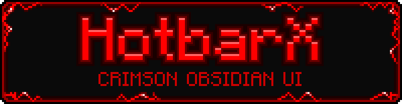
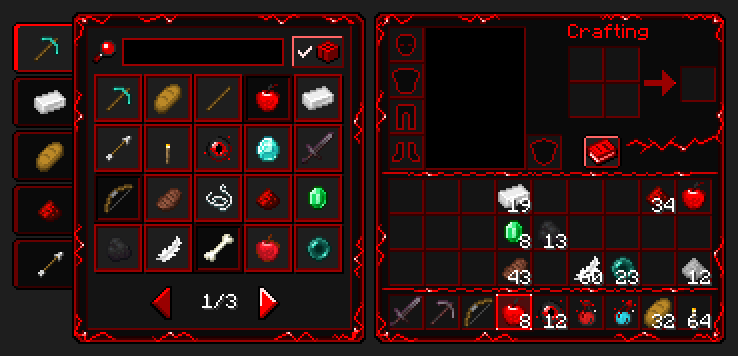
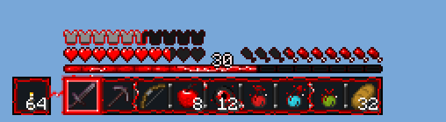
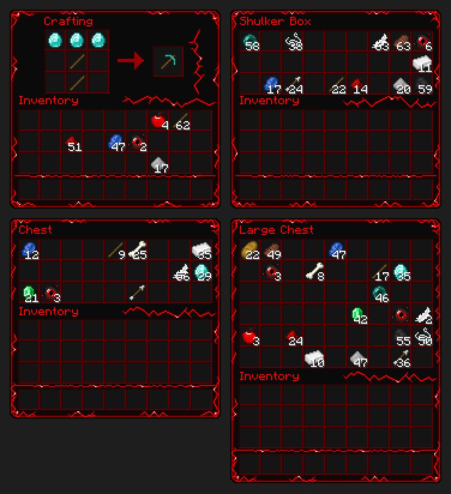
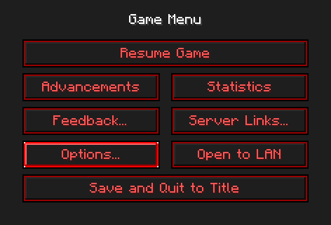
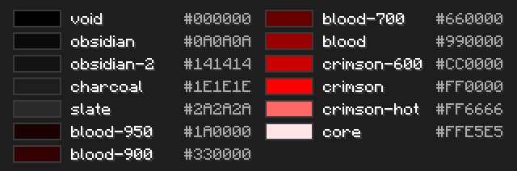

<p align="center">
  
</p>

<p align="center">
  A dark crimson and obsidian-black GUI resource pack for <b>Minecraft Java Edition 26.3</b>, which also loads in 26.2.<br>
  Matte black panels, thin blood-red borders, and red lightning that crackles along every frame. Not one gold, yellow or bronze pixel ships in the pack.
</p>

<p align="center">
  
</p>

## What it changes

| Area | Look |
|---|---|
| **Containers** | Inventory, crafting table, shulker box, and every chest-style screen: chest, large chest, barrel, ender chest, and 1–6-row server menus. Black panels edged by one thin crimson line that glows inward. Quiet dark-crimson slots. Jagged lightning along the frame, across the gaps between slot groups, and through the empty areas. |
| **Titles** | Container labels such as "Crafting", "Inventory" and "Shulker Box" are drawn in crimson (`#FF0000`). This also covers renamed chests and plain server menu titles. |
| **Recipe book** | Panel, search field, tabs, "craftable only" toggle, page arrows and variant popup. Craftable recipes stand out; the others go dark. |
| **HUD** | Animated hotbar whose lightning links the slots and plugs into the glowing selection frame on any slot. Offhand cell and attack indicator to match. Crimson hearts (hardcore, absorption and mount hearts too), blood-red hunger, obsidian armor, and an animated XP bar with a pale level number. |
| **Buttons** | Every button gets a crimson trim and a glowing hover state; text fields get a crimson border. Pause-menu text is red, and "Back to Game" becomes "Resume Game". |
| **Items** | The Golden Apple becomes the **Blood Apple** (red texture, red name). Potion bottles and the Eye of Ender crackle with red sparks. Tools stay vanilla. |

Poisoned, withered and frozen hearts, and the potion liquid colours, stay vanilla on purpose: their colour is gameplay information.

## Previews

These images are rendered by the generator from the pack's own textures, laid out as the game draws them. They are not in-game screenshots.

<p align="center">
  
</p>

<p align="center">
  
</p>

<p align="center">
  
</p>

## Install

1. Get the pack in one of these ways:
   - **Zip:** build `dist\HotbarX.zip` as described under [Build](#build).
   - **Folder:** use the `pack` folder itself, renamed to `HotbarX`. Minecraft loads unzipped packs too. GitHub's **Code → Download ZIP** gives you the whole repository, with the pack in its `pack` folder.
2. Put it into the `resourcepacks` folder of your game: `%APPDATA%\.minecraft\resourcepacks` for the vanilla launcher, or the profile's `resourcepacks` folder in the Modrinth App.
3. In game, open **Options → Resource Packs**, enable **HotbarX**, and move it to the top.

## Compatibility

- **Minecraft 26.3** (pack format 97.1) is the target. **26.2** (format 88) loads it too: the `mc_26_2` overlay swaps in the 26.2 version of the text shader.
- **Not tested in game yet.** The checklist is in [SPEC §12](docs/SPEC.md#12-acceptance-tests).
- The crimson labels come from a core-shader patch (`text.vsh`). It hasn't been tested with Sodium, Iris or ImmediatelyFast. If labels break, delete the shader and use the lang fallback in [SPEC §5.6](docs/SPEC.md#56-label-color-d3).
- Only the screens listed above are themed. Furnaces, anvils, villagers, creative tabs and modded screens stay vanilla, but their labels turn red too, with low contrast on light gray.
- The red button text and the Blood Apple name are set in `en_us`. In other languages, button text stays white; the textures apply either way.

## Palette

<p align="center">
  
</p>

Every token has green = blue, so every pixel is either a neutral gray or a pure red. That makes "no gold" checkable: `tools/Test-Palette.ps1 -Strict` fails on any pixel that drifts toward orange or yellow. Lightning is a 1-px `crimson` bolt with tapered ends, one white-hot strike point and a `blood-900` glow. The full rules are in [SPEC §4–5](docs/SPEC.md#4-palette).

## Build

Every texture in `pack/` is generated from the vanilla templates in a client jar, so a rebuild is the only way to change one. You need Java 17+ and a Minecraft 26.3 or 26.2 client jar; both produce identical textures. Without a jar argument, the generator looks in `.minecraft` and the Modrinth App, newest version first.

Run from the repository root in PowerShell:

```powershell
java tools/BuildTextures.java [path\to\client.jar] --readme docs\images
powershell -ExecutionPolicy Bypass -File tools\Test-Palette.ps1 pack -Strict
mkdir -Force dist
jar --create --no-manifest --file dist\HotbarX.zip -C pack .
```

- The generator writes `pack/` and fails on any broken rule: an off-palette pixel, an unlit hotbar anchor, a non-flat text zone, or a seam in the chest border. Reruns are byte-identical.
- `--readme docs\images` regenerates the images on this page. Rerun it whenever the textures change.
- `--preview <dir>` also writes enlarged review sheets: chests at 1, 3 and 6 rows, the hotbar with the selection on every slot, and buttons at five widths.

## Repository

| Path | Contents |
|---|---|
| [`pack/`](pack) | The resource pack. Textures are generated. `pack.mcmeta`, the lang file and the two shader copies are hand-written: the 26.3 base, and the 26.2 copy in the `mc_26_2` overlay. |
| [`tools/BuildTextures.java`](tools/BuildTextures.java) | Texture generator, layout checks, and the preview and README images |
| [`tools/Test-Palette.ps1`](tools/Test-Palette.ps1) | Palette check: fails on any gold, yellow or bronze pixel |
| [`docs/SPEC.md`](docs/SPEC.md) | Design specification: palette, texture geometry, lightning rules, engine limits, acceptance tests |
| [`docs/PROMPT.md`](docs/PROMPT.md) | Production brief and concept-art prompts |
| [`docs/images/`](docs/images) | The images on this page, generated |

---

<sub>Not an official Minecraft product. Not approved by or associated with Mojang or Microsoft.</sub>
